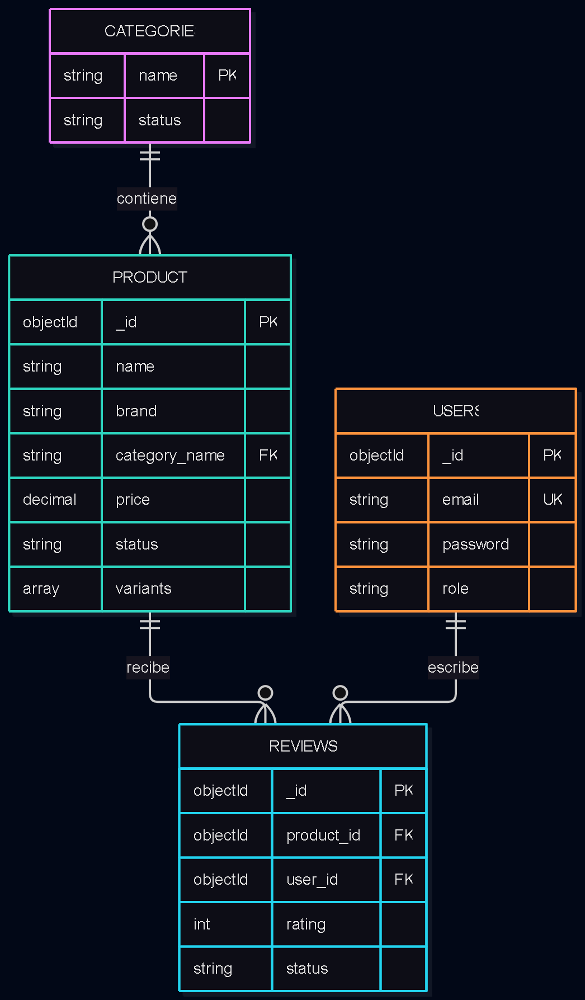

# Tarea 01:Diseña una base de datos documental con MongoDB

## 1.Definir el problema y los accesos

### 1.1. Escenario elegido y usuarios

- Escenario: Catálogo de comercio electrónico variable: productos, categorías, variantes, stock y reseñas. Justifica incrustación, referencias, índices y agregaciones.

- Usuarios: Cliente, Administrador

### 1.2. Preguntas

Consultas a realizar sobre la base de datos:

1. ¿Que productos de la categoria "electronica" tienen un precio inferior a 100 €?

2. ¿Productos que coiciden con la palabra "televisión" en el nombre?

3. ¿Qué productos estan casi agotados?

4. ¿Que reseñas tienen un valoración positiva?

5. ¿Cuales son las variantes de un producto?

6. ¿Cuales son los productos disponibles de una marca?

### 1.3. Los datos que se leen y escriben con mayor frecuencia

Los datos a los que mas se accederan seran:

- Productos
- Categorías

Los datos a los que mas se escribira seran:

- Reseñas
- Nombre de producto

### 1.4. Tabla que relacione las preguntas con las colecciones

| Pregunta | Coleccion  | Filtro                | Acceso        |
|----------|------------|-----------------------|---------------|
| 1        | Productos  | Categoria/precio      | Cliente       |
| 2        | Productos  | marca                 | Cliente       |
| 3        | Productos  | stock                 | Administrador |
| 4        | reviews    | Puntuacion            | Todos         |
| 5        | Productos  | Idobjeto/variante     | Todos         |
| 6        | Productos  | Marca                 | Cliente       |

#### Índices

Para las pregunta 1 {catgeoria,precio y estado}
Para la pregunta 2 {nombre}
Para la pregunta 3 {stock}
Para la pregunta 4 {productoID y rating}
Para la pregunta 6 {marca}

### 1.5. Requisitos de seguridad

Seguridad: Ciframos todo el tráfico entre la aplicación y el clúster de Atlas usando TLS/SSL para evitar intercepciones, y forzamos contraseñas seguras para la autenticación de usuarios.

Privacidad (RGPD): Al ser información sensible, datos personales como emails y direcciones de entrega se anonimizan obligatoriamente antes de exportar la base de datos a entornos de pruebas o desarrollo.

Disponibilidad: Nos apoyamos en la arquitectura de Replica Set de MongoDB Atlas; si un nodo falla, el sistema conmuta automáticamente a una réplica para que la tienda siga operativa sin perder ventas.

Escalabilidad: Diseñamos el modelo de datos y las relaciones de forma preventiva para optimizar el espacio y no acercarnos nunca al límite de 16 MB por documento en MongoDB.

## 2. Diseñar las colecciones

### 2.1. Colecciones y propositos

- categories: Almacenar las categoríasdel catálogo para filtrado, navegación y menús.
- products: Almacenar los productos, sus variantes y sus propiedades.
- reviews: Almacenar las reseñas de los clientes.
- users: Almacenar los usuarios y sus permisos.



### 2.2. Documentos de ejemplo

#### Categories

```json
{
  "_id": "electronica",
  "name": "Electrónica",
  "status": "active",
  "createdAt": { "$date": "2026-01-15T10:00:00.000Z" },
  "updatedAt": { "$date": "2026-01-15T10:00:00.000Z" }
}
```

#### Products

```json
{
  "_id": { "$oid": "6644f1a2e4b0a1c2d3e4f502" },
  "name": "Auriculares Inalámbricos Pro",
  "brand": "TechAudio",
  "category_id": "electronica",
  "price": { "$numberDecimal": "79.99" },
  "status": "active",
  "variants": [
    {
      "abrv": "NEG-STD",
      "stock": 45
    },
    {
      "abrv": "BLA-STD",
      "stock": 12
    }
  ],
  "createdAt": { "$date": "2026-03-01T12:00:00.000Z" },
  "updatedAt": { "$date": "2026-04-12T16:20:00.000Z" }
}
```

#### Users

```json

{
  "_id": { "$oid": "6644f1a2e4b0a1c2d3e4f501" },
  "email": "carlos.garcia@example.com",
  "password": "$2b$12$e8YkZ8r3H9XbYjW5qP0O1uK9uS0tW6vR1qL2mN3oP4qR5sT6uV7wX",
  "role": "customer",
  "createdAt": { "$date": "2026-02-10T08:30:00.000Z" },
  "updatedAt": { "$date": "2026-02-10T08:30:00.000Z" }
}

```

#### Reviews

```json
{
  "_id": { "$oid": "6644f1a2e4b0a1c2d3e4f503" },
  "product_id": { "$oid": "6644f1a2e4b0a1c2d3e4f502" },
  "user_id": { "$oid": "6644f1a2e4b0a1c2d3e4f501" },
  "rating": 5,
  "comment": "Excelente cancelación de ruido y duración de batería.",
  "status": "approved",
  "createdAt": { "$date": "2026-04-15T09:15:30.000Z" },
  "updatedAt": { "$date": "2026-04-15T10:00:00.000Z" }
}

```

### 2.3. Decisión de Modelado

- Incrustacion dentro de productos: ya que un producto puede tener varias variantes, y cada una de ellas puede tener diferente disponibilidad y esto se tiene que mostrar. Y asu vez posee una baja cardinalidad ya que las varianes no suelen superar las 10.
- Referencia: Una review tiene que tener una referencia a el producto el cual se esta valorando y por quien se valora.

### 2.4. Estrategia para IDs

- identficadores de objetos: ObjectId es autogenerado por MongoDB, y es un identificador que garantiza que sea único en el sistema.
- Fechas: Datos BSON para poder hacer consultas de fechas, y para poder ordenar por fecha.
- Estados: Para poder clasificar productos y usuarios .

### 2.5. Limites

-Limite de 16MB por documento. Los productos ocupan mucho menos espacio aproximadamente unos 4KB.
-Evitar Arrays anidados. ya que las reviews de usuarios se extraeon de otra coleccion su producto especifico evitando que sean infinitos.

## 3.Implementar Validación e Índices

### 3.1.Creas las colecciones

```js
//Creación de colecciones y validaciones
db.createCollection("categories", {
  validator: {
    $jsonSchema: {
      bsonType: "object",
      required: ["name", "status"],
      properties: {
        name: { bsonType: "string" },
        status: { enum: ["active", "inactive"] }
      }
    }
  }
});
db.createCollection("products", {
  validator: {
    $jsonSchema: {
      bsonType: "object",
      required: ["name", "brand", "category_name", "price", "status", "variants"],
      properties: {
        name: { bsonType: "string" },
        brand: { bsonType: "string" },
        category_name: { bsonType: "string" },
        price: { bsonType: "decimal" },
        status: { enum: ["active", "inactive"] },
        variants: {
          bsonType: "array",
          items: {
            bsonType: "object",
            required: ["abrv", "stock"],
            properties: {
              abrv: { bsonType: "string" },
              stock: { bsonType: "int", minimum: 0 }
            }
          }
        }
      }
    }
  }
});
db.createCollection("reviews", {
  validator: {
    $jsonSchema: {
      bsonType: "object",
      required: ["product_id", "rating", "status"],
      properties: {
        product_id: { bsonType: "objectId" },
        user_id: { bsonType: "objectId",},
        rating: { bsonType: "int", minimum: 1, maximum: 5 },
        status: { enum: ["approved", "pending", "rejected"] }
      }
    }
  }
});

db.createCollection("users", {
  validator: {
    $jsonSchema: {
      bsonType: "object",
      required: ["email", "password", "role"],
      properties: {
        email: {bsonType: "string", pattern: "^[a-zA-Z0-9._%+-]+@[a-zA-Z0-9.-]+\\.[a-zA-Z]{2,}$",},
        password: {bsonType: "string",},
        role: {enum: ["admin", "customer", "moderator"],}
      }
    }
  }
});
```

#### prueba de rechazo


Para comprobar que no se pueden insertar documentos con campos que no cumplen las vadilaciones.

### 3.2 y 3.3 Indices

```js
//Indices para buscar un categoria ya que son unicas 
db.categories.createIndex({ name: 1 }, { unique: true });

//Indices para buscar productos por categoria, precio y estado, 
db.products.createIndex({ category_name: 1, price: 1, status: 1 });
//Filtrado por texto
db.products.createIndex({ name: "text"});
//Filtrado por stock y marcas
db.products.createIndex({ "variants.stock": 1 });
db.products.createIndex({ brand: 1, status: 1 });

//Indices para buscar reseñas por producto y estado 
db.reviews.createIndex({ product_id: 1, rating: -1});
db.reviews.createIndex({ rating: -1, status: 1 });
db.reviews.createIndex({ user_id: 1 });

//Indices para buscar usuarios por email
db.users.createIndex({ email: 1 }, { unique: true });
```

#### Validaciones

- db.products.createIndex({ category_name: 1, price: 1, status: 1 }); aqui por ejemplo sirve para acortar el espacio de la busqueda a solo las categorias con es nombre , y los productos que este activos y poder luego ordenarlo por precio.

- db.reviews.createIndex({ product_id: 1, rating: -1}); aqui conseguimos clasificar las reseñas por el producto acortando asi el espacio de la busqueda.

### 3.5 Evidencia el plan de una consulta con explain("executionStats")


|Metrica|Antes|Despues|
|-------|-----|-------|
|Estapa|COLLSCAN + SORT|IXSCAN -> FETCH|
|Examinacion|Examina todos los documentos|Solo los que cumplen con la condicion|
|tiempo|aumenta conforme la cantidad de documentos|practicamente nulo|

## 4Resolver consultas

### 4.1. Inserción, actualización parcial y eliminación o desactivación lógica

```js
const catHogar = db.categories.insertOne({
  name: "Hogar y Cocina",
  status: "active",
  created_at: new Date()
});

db.products.updateOne(
  { name: "Aspirador Robot Xiaomi Smart Clean", "variants.abrv": "ROB-BLA", "variants.stock": { $gte: 1 } },
  { $inc: { "variants.$.stock": -1 } }
);

db.products.updateOne(
  { name: "Aspirador Robot Xiaomi Smart Clean" },
  {
    $set: {
      status: "inactive",
      deactivated_at: new Date(),
      deactivation_reason: "Descatalogado temporalmente por el administrador"
    }
  }
);
```

### 4.2. Filtros combinados

```js
db.products.find(
  { category_name: "Electrónica", status: "active", price: { $gte: NumberDecimal("10.00") } },
  { name: 1, price: 1, brand: 1 }
)
.sort({ price: 1, _id: 1 })
.skip(0)
.limit(10);
```

### 4.3. consulta que use una referencia mediante $lookup

```js
db.products.aggregate([
  {
    $match: { name: "Televisión Sony Bravia 4K Ultra HD" }
  },
  {
    $lookup: {
      from: "reviews",
      localField: "_id",
      foreignField: "product_id",
      as: "detailed_reviews"
    }
  },
  {
    $project: {
      name: 1,
      brand: 1,
      price: 1,
      "variants.abrv": 1,
      "variants.stock": 1,
      "detailed_reviews.user_name": 1,
      "detailed_reviews.rating": 1,
      "detailed_reviews.comment": 1
    }
  }
]);
```

### 4.4. Agregacion compleja de 4 etapas

```js
//Agregacion compleja
db.products.aggregate([
  // Etapa 1
  {
    $match: {
      category_name: "Electrónica",
      status: "active"
    }
  },

  // Etapa 2
  {
    $unwind: "$variants"
  },

  // Etapa 3
  {
    $lookup: {
      from: "reviews",
      let: { prodId: "$_id" },
      pipeline: [
        { $match: { $expr: { $and: [{ $eq: ["$product_id", "$$prodId"] }, { $eq: ["$status", "approved"] }] } } }
      ],
      as: "product_reviews"
    }
  },

  // Etapa 4
  {
    $group: {
      _id: "$brand",
      total_units_in_stock: { $sum: "$variants.stock" },
      avg_catalog_price: { $avg: "$price" },
      distinct_products: { $addToSet: "$name" }
    }
  },
  // Etapa 5
  {
    $facet: {
      inventory_ranking: [
        { $sort: { total_units_in_stock: -1 } }
      ],
      brand_summary: [
        {
          $group: {
            _id: null,
            total_brands: { $sum: 1 },
            global_units: { $sum: "$total_units_in_stock" }
          }
        }
      ]
    }
  }
]);
```

### 4.5. Analisis de la consulta

- Etapa 1 ($match): Filtra la colección para quedarse únicamente con los productos que pertenecen a la categoría "Electrónica" y cuyo estado es "active", descartando el resto.

- Etapa 2 ($unwind): Separa el array variants de cada producto. Si un televisor tiene 2 variantes , genera 2 documentos independientes, cada uno conteniendo una única variante con su respectivo stock.

- Etapa 3 ($lookup): Busca en la colección reviews todas las opiniones aprobadas asociadas a cada producto (product_id ==_id).

- Etapa 4 ($group): Agrupa todos los documentos por el campo brand. Suma el stock de cada variante individual, hace el promedio de los precios y recopila los nombres únicos de productos.

- Etapa 5 ($facet): Toma la salida del agrupamiento y la separa en dos sub-procesos: uno ordena las marcas por inventario disponible y el otro calcula los totales globales de la categoría.

## 5 Copia de Seguridad,Seguridad y Límites

### 5.1.Procedimiento de Copia y Restauración

El procedimiento utiliza las herramientas nativas del MongoDB Database Tools (mongodump y mongorestore) para copias lógicas consistentes, además de describir la alternativa gestionada en MongoDB Atlas.

```bash
mongodump --uri="mongodb+srv://<username>:<password>@<cluster-url>/test?retryWrites=true&w=majority" --gzip
```

```bash
mongorestore --uri="mongodb+srv://<username>:<password>@<cluster-url>/test?retryWrites=true&w=majority" --gzip --drop
```

### 5.2. Usuarios y Roles

- Cliente: Tiene permisos de lectura y escritura unicamente sobre la base de datos, si la web sufre un ataquue no podria acceder a otras funciones desde este rol.
- Administrador:Protegidos con seguridad de autenticación y limitados por una lista de ip.

### 5.3. Datos a Cifrar,Anonimizar y Excluir

- Anonimizar: Ofuscar los datos de los usuarios para que no muestren los datos reales de lso usuarios.

