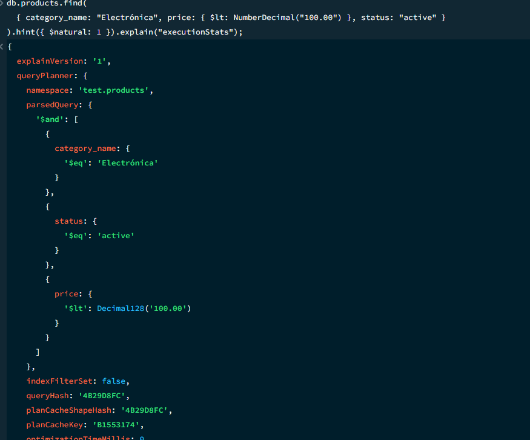

## 3.Implementar Validación e Índices

### 3.1.Creas las colecciones

```js
//Creación de colecciones y validaciones
db.createCollection("categories", {
  validator: {
    $jsonSchema: {
      bsonType: "object",
      required: ["name", "status"],
      properties: {
        name: { bsonType: "string" },
        status: { enum: ["active", "inactive"] }
      }
    }
  }
});
db.createCollection("products", {
  validator: {
    $jsonSchema: {
      bsonType: "object",
      required: ["name", "brand", "category_name", "price", "status", "variants"],
      properties: {
        name: { bsonType: "string" },
        brand: { bsonType: "string" },
        category_name: { bsonType: "string" },
        price: { bsonType: "decimal" },
        status: { enum: ["active", "inactive"] },
        variants: {
          bsonType: "array",
          items: {
            bsonType: "object",
            required: ["abrv", "stock"],
            properties: {
              abrv: { bsonType: "string" },
              stock: { bsonType: "int", minimum: 0 }
            }
          }
        }
      }
    }
  }
});
db.createCollection("reviews", {
  validator: {
    $jsonSchema: {
      bsonType: "object",
      required: ["product_id", "rating", "status"],
      properties: {
        product_id: { bsonType: "objectId" },
        user_id: { bsonType: "objectId",},
        rating: { bsonType: "int", minimum: 1, maximum: 5 },
        status: { enum: ["approved", "pending", "rejected"] }
      }
    }
  }
});

db.createCollection("users", {
  validator: {
    $jsonSchema: {
      bsonType: "object",
      required: ["email", "password", "role"],
      properties: {
        email: {bsonType: "string", pattern: "^[a-zA-Z0-9._%+-]+@[a-zA-Z0-9.-]+\\.[a-zA-Z]{2,}$",},
        password: {bsonType: "string",},
        role: {enum: ["admin", "customer", "moderator"],}
      }
    }
  }
});
```

#### prueba de rechazo


Para comprobar que no se pueden insertar documentos con campos que no cumplen las vadilaciones.

### 3.2 y 3.3 Indices

```js
//Indices para buscar un categoria ya que son unicas 
db.categories.createIndex({ name: 1 }, { unique: true });

//Indices para buscar productos por categoria, precio y estado, 
db.products.createIndex({ category_name: 1, price: 1, status: 1 });
//Filtrado por texto
db.products.createIndex({ name: "text"});
//Filtrado por stock y marcas
db.products.createIndex({ "variants.stock": 1 });
db.products.createIndex({ brand: 1, status: 1 });

//Indices para buscar reseñas por producto y estado 
db.reviews.createIndex({ product_id: 1, rating: -1});
db.reviews.createIndex({ rating: -1, status: 1 });
db.reviews.createIndex({ user_id: 1 });

//Indices para buscar usuarios por email
db.users.createIndex({ email: 1 }, { unique: true });
```

#### Validaciones

- db.products.createIndex({ category_name: 1, price: 1, status: 1 }); aqui por ejemplo sirve para acortar el espacio de la busqueda a solo las categorias con es nombre , y los productos que este activos y poder luego ordenarlo por precio.

- db.reviews.createIndex({ product_id: 1, rating: -1}); aqui conseguimos clasificar las reseñas por el producto acortando asi el espacio de la busqueda.

### 3.5 Evidencia el plan de una consulta con explain("executionStats")



|Metrica|Antes|Despues|
|-------|-----|-------|
|Estapa|COLLSCAN + SORT|IXSCAN -> FETCH|
|Examinacion|Examina todos los documentos|Solo los que cumplen con la condicion|
|tiempo|aumenta conforme la cantidad de documentos|practicamente nulo|

## 4Resolver consultas

### 4.1. Inserción, actualización parcial y eliminación o desactivación lógica

```js
const catHogar = db.categories.insertOne({
  name: "Hogar y Cocina",
  status: "active",
  created_at: new Date()
});

db.products.updateOne(
  { name: "Aspirador Robot Xiaomi Smart Clean", "variants.abrv": "ROB-BLA", "variants.stock": { $gte: 1 } },
  { $inc: { "variants.$.stock": -1 } }
);

db.products.updateOne(
  { name: "Aspirador Robot Xiaomi Smart Clean" },
  {
    $set: {
      status: "inactive",
      deactivated_at: new Date(),
      deactivation_reason: "Descatalogado temporalmente por el administrador"
    }
  }
);
```

### 4.2. Filtros combinados

```js
db.products.find(
  { category_name: "Electrónica", status: "active", price: { $gte: NumberDecimal("10.00") } },
  { name: 1, price: 1, brand: 1 }
)
.sort({ price: 1, _id: 1 })
.skip(0)
.limit(10);
```

### 4.3. consulta que use una referencia mediante $lookup

```js
db.products.aggregate([
  {
    $match: { name: "Televisión Sony Bravia 4K Ultra HD" }
  },
  {
    $lookup: {
      from: "reviews",
      localField: "_id",
      foreignField: "product_id",
      as: "detailed_reviews"
    }
  },
  {
    $project: {
      name: 1,
      brand: 1,
      price: 1,
      "variants.abrv": 1,
      "variants.stock": 1,
      "detailed_reviews.user_name": 1,
      "detailed_reviews.rating": 1,
      "detailed_reviews.comment": 1
    }
  }
]);
```

### 4.4. Agregacion compleja de 4 etapas

```js
//Agregacion compleja
db.products.aggregate([
  // Etapa 1
  {
    $match: {
      category_name: "Electrónica",
      status: "active"
    }
  },

  // Etapa 2
  {
    $unwind: "$variants"
  },

  // Etapa 3
  {
    $lookup: {
      from: "reviews",
      let: { prodId: "$_id" },
      pipeline: [
        { $match: { $expr: { $and: [{ $eq: ["$product_id", "$$prodId"] }, { $eq: ["$status", "approved"] }] } } }
      ],
      as: "product_reviews"
    }
  },

  // Etapa 4
  {
    $group: {
      _id: "$brand",
      total_units_in_stock: { $sum: "$variants.stock" },
      avg_catalog_price: { $avg: "$price" },
      distinct_products: { $addToSet: "$name" }
    }
  },
  // Etapa 5
  {
    $facet: {
      inventory_ranking: [
        { $sort: { total_units_in_stock: -1 } }
      ],
      brand_summary: [
        {
          $group: {
            _id: null,
            total_brands: { $sum: 1 },
            global_units: { $sum: "$total_units_in_stock" }
          }
        }
      ]
    }
  }
]);
```

### 4.5. Analisis de la consulta

- Etapa 1 ($match): Filtra la colección para quedarse únicamente con los productos que pertenecen a la categoría "Electrónica" y cuyo estado es "active", descartando el resto.

- Etapa 2 ($unwind): Separa el array variants de cada producto. Si un televisor tiene 2 variantes , genera 2 documentos independientes, cada uno conteniendo una única variante con su respectivo stock.

- Etapa 3 ($lookup): Busca en la colección reviews todas las opiniones aprobadas asociadas a cada producto (product_id ==_id).

- Etapa 4 ($group): Agrupa todos los documentos por el campo brand. Suma el stock de cada variante individual, hace el promedio de los precios y recopila los nombres únicos de productos.

- Etapa 5 ($facet): Toma la salida del agrupamiento y la separa en dos sub-procesos: uno ordena las marcas por inventario disponible y el otro calcula los totales globales de la categoría.
