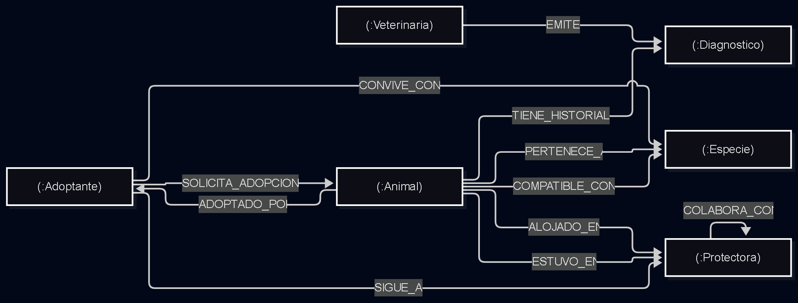

## 2 Diseñar el grafo de nodos y relaciones

### 2.1 Etiquetas de los nodos

- **Animal:** Mascotas rescatadas en la red (id, nombre, estado, nivel_energia, fecha_rescate, necesidades_especiales, edad_aprox).

- **Adoptante:** Usuarios registrados que solicitan adoptar (id, nombre, tipo_vivienda, horas_solo, experiencia_previa, codigo_postal).

- **Protectora:** Albergues, refugios y hogares de acogida unificados (cif, nombre, capacidad_maxima, telefono_contacto, codigo_postal, admite_cuidados_medicos).

- **Especie:** Categoría para control de convivencia y compatibilidad (nombre).

- **Veterinaria:** Clínicas y facultativos que certifican la salud y comportamiento (num_vet, nombre, especialidad).ç

### 2.2 tipos de relaciones

- (:Animal)-[:PERTENECE_A]->- (:Especie)

- (:Animal)-[:COMPATIBLE_CON {grado: "ALTO", validado_por_etologo: true}]->- (:Especie)

- (:Adoptante)-[:CONVIVE_CON {cantidad: 1}]->- (:Especie)

- (:Adoptante)-[:SIGUE_A {desde: "2026-02-15"}]->- (:Protectora)

- (:Adoptante)-[:SOLICITA_ADOPCION {fecha: "2026-09-01", estado: "PENDIENTE"}]->- (:Animal)

- (:Animal)-[:ADOPTADO_POR {fecha_adopcion: "2026-10-15"}]->- (:Adoptante)

- (:Animal)-[:ALOJADO_EN {desde: "2026-03-20"}]->- (:Protectora)

- (:Animal)-[:ESTUVO_EN {desde: "2026-01-10", hasta: "2026-03-19", motivo: "Saturación"}]->- (:Protectora)

- (:Protectora)-[:COLABORA_CON {distancia_km: 45, activa: true}]->- (:Protectora)

- (:Veterinaria)-[:SUPERVISA {fecha: "2026-04-10", diagnostico: "Sano", tratamiento: "Ninguno"}]->- (:Animal)

### 2.3 justificacion

1. Entidades modeladas como Nodos (:Especie, :Protectora, :Veterinaria)

- :Especie: Funciona como nodo puente para resolver compatibilidades en tiempo real (:Adoptante -> :Especie <- :Animal) mediante saltos directos de memoria, evitando escaneos lentos de texto. Permite, además, asignar propiedades [:COMPATIBLE_CON] (grado, validado_por_veterinario).

- :Protectora: Entidad autónoma con aforo y operativa propia. Modelarla como nodo permite calcular plazas libres agregando punteros entrantes (count) y trazar colaboraciones entre centros mediante [:COLABORA_CON].

- :Veterinaria: Entidad clínica independiente que atiende a múltiples animales. Permite auditar el historial médico asociando fecha, diagnostico y tratamiento directamente a la relación [:SUPERVISA].

2. Atributos modelados como Propiedades (tipo_vivienda, nivel_energia, estado)

- tipo_vivienda y horas_solo (en :Adoptante): Atributos puramente descriptivos del hogar que actúan como filtros secundarios (WHERE) sin necesidad de actuar como puntos de cruce en el grafo.

- nivel_energia y estado (en :Animal): Datos con valores finitos y muy repetidos ("DISPONIBLE", "ADOPTADO"). Modelarlos como nodos crearía supernodos que degradarían el rendimiento; como propiedades indexadas permiten búsquedas directas sin saturar la memoria.

- diagnostico y tratamiento (en la relación [:SUPERVISA]): Describen un acto clínico específico en una fecha concreta; no justifican nodos propios al no requerir cálculos de caminos topológicos a través de patologías.

### 2.4 Estrategia para identidicadores único y tipo de datos compatibles con Cypher

- Identificadores unívocos: Códigos legibles de negocio (id: "A-01", id: "PRO-01", cif: "G-10111213", num_vet: "VET-2801" y nombre: "Perro"), respaldados por restricciones de unicidad (IS UNIQUE)

- Propiedades en las relaciones: Relaciones como [:COMPATIBLE_CON] (grado, validado_por_etologo) o [:SUPERVISA] (fecha, diagnostico, tratamiento) almacenan sus propios atributos. Esto evita crear tablas o colecciones intermedias

### 2.5 Limites y riesgos del modelo

- Antipatrón de Supernodos en Especies: : Un nodo categórico como la especie Perro cumularía decenas de miles de relaciones directas. Si una consulta parte de estos nodos densos para recorrer animales y adoptantes, la memoria se saturará y la consulta se volverá lenta.

  - Solución: las búsquedas nunca comienzan en el nodo especie para barrer todo el grafo; parten siempre de un adoptante concreto (:Adoptante {id: $id}) y la especie actúa únicamente como puente de validación en dos saltos controlados.

- Profundidad de saltos acotada en colaboraciones: En la red de alianzas entre centros (:Protectora), buscar derivaciones o plazas disponibles sin restricción de distancia provocaría una explosión combinatoria inasumible.
  
  - Solución: Se acota formalmente la exploración a un máximo prudente mediante longitudes de camino finitas ([:COLABORA_CON*1..3]).
