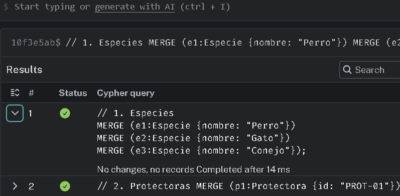

## 3. Implementar restricciones, índices y carga de datos

### 3.1 Restricciones de unicidad

``` js
// 1. Restricción de unicidad para Animales 
CREATE CONSTRAINT constraint_animal_id IF NOT EXISTS
FOR (a:Animal)
REQUIRE a.id IS UNIQUE;

// 2. Restricción de unicidad para Adoptantes 
CREATE CONSTRAINT constraint_adoptante_id IF NOT EXISTS
FOR (ad:Adoptante)
REQUIRE ad.id IS UNIQUE;

// 3. Restricción de unicidad para Protectoras 
CREATE CONSTRAINT constraint_protectora_cif IF NOT EXISTS
FOR (p:Protectora)
REQUIRE p.id IS UNIQUE;

// 4. Restricción de unicidad para Especies 
CREATE CONSTRAINT constraint_especie_nombre IF NOT EXISTS
FOR (e:Especie)
REQUIRE e.nombre IS UNIQUE;

// 5. Restricción de unicidad para Veterinarias 
CREATE CONSTRAINT constraint_veterinaria_num IF NOT EXISTS
FOR (v:Veterinaria)
REQUIRE v.id IS UNIQUE;

```

### 3.2 Índices secundarios

``` js
// 1. Índice para filtrar animales por estado 
CREATE INDEX index_animal_estado IF NOT EXISTS
FOR (a:Animal)
ON (a.estado);

// 2. Índice compuesto para catálogo: filtra por estado y ordena por antigüedad de rescate
CREATE INDEX index_animal_catalogo IF NOT EXISTS
FOR (a:Animal)
ON (a.estado, a.fecha_rescate);

// 3. Índice por nivel de energía para matching rápido con el tipo de vivienda
CREATE INDEX index_animal_energia IF NOT EXISTS
FOR (a:Animal)
ON (a.nivel_energia);

// 4. Índice geográfico por código postal para búsqueda de protectoras cercanas
CREATE INDEX index_protectora_cp IF NOT EXISTS
FOR (p:Protectora)
ON (p.codigo_postal);

// 5. Índice geográfico por código postal para adoptantes
CREATE INDEX index_adoptante_cp IF NOT EXISTS
FOR (ad:Adoptante)
ON (ad.codigo_postal);
```

### 3.3 y 3,4 Carga controlada con MERGE y Dataset de prueba

``` js
// 1. Especies 
MERGE (e1:Especie {nombre: "Perro"})
MERGE (e2:Especie {nombre: "Gato"})
MERGE (e3:Especie {nombre: "Conejo"});

// 2. Protectoras 
MERGE (p1:Protectora {id: "PROT-01"})
ON CREATE SET 
    p1.nombre = "Huellas del Valle",
    p1.capacidad_maxima = 30,
    p1.telefono_contacto = "600111222",
    p1.codigo_postal = "10001",
    p1.admite_cuidados_medicos = true;

MERGE (p2:Protectora {id: "PROT-02"})
ON CREATE SET 
    p2.nombre = "Refugio San Roque",
    p2.capacidad_maxima = 20,
    p2.telefono_contacto = "600222333",
    p2.codigo_postal = "10003",
    p2.admite_cuidados_medicos = false;

MERGE (p3:Protectora {id: "PROT-03"})
ON CREATE SET 
    p3.nombre = "Acogidas Extremadura",
    p3.capacidad_maxima = 15,
    p3.telefono_contacto = "600333444",
    p3.codigo_postal = "10600",
    p3.admite_cuidados_medicos = true;

MERGE (p4:Protectora {id: "PROT-04"})
ON CREATE SET 
    p4.nombre = "Santuario La Serena",
    p4.capacidad_maxima = 25,
    p4.telefono_contacto = "600444555",
    p4.codigo_postal = "06400",
    p4.admite_cuidados_medicos = false;

// 3. Veterinarias
MERGE (v1:Veterinaria {id: "VET-01"})
ON CREATE SET 
    v1.nombre = "Clínica Veterinaria San Antón",
    v1.especialidad = "Medicina General";

MERGE (v2:Veterinaria {id: "VET-02"})
ON CREATE SET 
    v2.nombre = "Centro Etológico Canino y Felino",
    v2.especialidad = "Etología";

// 4. Animales rescatados
MERGE (a1:Animal {id: "A-01"})
ON CREATE SET 
    a1.nombre = "Rocky",
    a1.estado = "DISPONIBLE",
    a1.nivel_energia = "MEDIO",
    a1.fecha_rescate = date("2026-01-15"),
    a1.necesidades_especiales = false,
    a1.edad_aprox = 3;

MERGE (a2:Animal {id: "A-02"})
ON CREATE SET 
    a2.nombre = "Luna",
    a2.estado = "DISPONIBLE",
    a2.nivel_energia = "BAJO",
    a2.fecha_rescate = date("2026-02-10"),
    a2.necesidades_especiales = true,
    a2.edad_aprox = 5;

MERGE (a3:Animal {id: "A-03"})
ON CREATE SET 
    a3.nombre = "Thor",
    a3.estado = "EN_ACOGIDA",
    a3.nivel_energia = "ALTO",
    a3.fecha_rescate = date("2025-11-05"),
    a3.necesidades_especiales = false,
    a3.edad_aprox = 1;

MERGE (a4:Animal {id: "A-04"})
ON CREATE SET 
    a4.nombre = "Mimi",
    a4.estado = "ADOPTADO",
    a4.nivel_energia = "MEDIO",
    a4.fecha_rescate = date("2025-08-20"),
    a4.necesidades_especiales = false,
    a4.edad_aprox = 2;

// 5. Adoptantes
MERGE (ad1:Adoptante {id: "USR-01"})
ON CREATE SET 
    ad1.nombre = "Carlos Gómez",
    ad1.tipo_vivienda = "PISO",
    ad1.horas_solo = 4,
    ad1.experiencia_previa = true,
    ad1.codigo_postal = "10001";

MERGE (ad2:Adoptante {id: "USR-02"})
ON CREATE SET 
    ad2.nombre = "Elena Rivas",
    ad2.tipo_vivienda = "CASA_CON_JARDIN",
    ad2.horas_solo = 2,
    ad2.experiencia_previa = false,
    ad2.codigo_postal = "10003";
MERGE (ad3:Adoptante {id: "USR-03"})
ON CREATE SET 
    ad3.nombre = "Marcos Peña",
    ad3.tipo_vivienda = "CHALET",
    ad3.horas_solo = 1,
    ad3.experiencia_previa = true,
    ad3.codigo_postal = "06400";

// Pertinencia de especie
MATCH (a:Animal {id: "A-01"}), (e:Especie {nombre: "Perro"})
MERGE (a)-[:PERTENECE_A]->(e);

MATCH (a:Animal {id: "A-02"}), (e:Especie {nombre: "Gato"})
MERGE (a)-[:PERTENECE_A]->(e);

MATCH (a:Animal {id: "A-03"}), (e:Especie {nombre: "Perro"})
MERGE (a)-[:PERTENECE_A]->(e);

MATCH (a:Animal {id: "A-04"}), (e:Especie {nombre: "Gato"})
MERGE (a)-[:PERTENECE_A]->(e);

// Compatibilidad con otras especies
MATCH (a:Animal {id: "A-01"}), (e:Especie {nombre: "Gato"})
MERGE (a)-[r:COMPATIBLE_CON]->(e)
ON CREATE SET r.grado = "ALTO", r.validado_por_etologo = true;

MATCH (a:Animal {id: "A-01"}), (e:Especie {nombre: "Perro"})
MERGE (a)-[r:COMPATIBLE_CON]->(e)
ON CREATE SET r.grado = "ALTO", r.validado_por_etologo = true;

MATCH (a:Animal {id: "A-03"}), (e:Especie {nombre: "Perro"})
MERGE (a)-[r:COMPATIBLE_CON]->(e)
ON CREATE SET r.grado = "MEDIO", r.validado_por_etologo = false;

// Convivencia actual de adoptantes
MATCH (ad:Adoptante {id: "USR-01"}), (e:Especie {nombre: "Gato"})
MERGE (ad)-[r:CONVIVE_CON]->(e)
ON CREATE SET r.cantidad = 1;

MATCH (ad:Adoptante {id: "USR-02"}), (e:Especie {nombre: "Perro"})
MERGE (ad)-[r:CONVIVE_CON]->(e)
ON CREATE SET r.cantidad = 1;
// Seguimiento a protectoras
MATCH (ad:Adoptante {id: "USR-01"}), (p:Protectora {id: "PROT-01"})
MERGE (ad)-[r:SIGUE_A]->(p)
ON CREATE SET r.desde = date("2026-03-01");

MATCH (ad:Adoptante {id: "USR-02"}), (p:Protectora {id: "PROT-02"})
MERGE (ad)-[r:SIGUE_A]->(p)
ON CREATE SET r.desde = date("2026-03-15");

MATCH (ad:Adoptante {id: "USR-03"}), (p:Protectora {id: "PROT-04"})
MERGE (ad)-[r:SIGUE_A]->(p)
ON CREATE SET r.desde = date("2026-01-20");

// Ubicación y custodia actual de animales
MATCH (a:Animal {id: "A-01"}), (p:Protectora {id: "PROT-01"})
MERGE (a)-[r:ALOJADO_EN]->(p)
ON CREATE SET r.desde = date("2026-01-15");

MATCH (a:Animal {id: "A-02"}), (p:Protectora {id: "PROT-01"})
MERGE (a)-[r:ALOJADO_EN]->(p)
ON CREATE SET r.desde = date("2026-02-10");

MATCH (a:Animal {id: "A-03"}), (p:Protectora {id: "PROT-02"})
MERGE (a)-[r:ALOJADO_EN]->(p)
ON CREATE SET r.desde = date("2026-03-01");

// Historial de traslados previos
MATCH (a:Animal {id: "A-03"}), (p:Protectora {id: "PROT-03"})
MERGE (a)-[r:ESTUVO_EN]->(p)
ON CREATE SET 
    r.desde = date("2025-11-05"),
    r.hasta = date("2026-02-28"),
    r.motivo = "Derivación por saturación de plazas";

// Red de convenios y colaboración entre protectoras
MATCH (p1:Protectora {id: "PROT-01"}), (p2:Protectora {id: "PROT-02"})
MERGE (p1)-[r:COLABORA_CON]->(p2)
ON CREATE SET r.distancia_km = 12, r.activa = true;

MATCH (p1:Protectora {id: "PROT-01"}), (p3:Protectora {id: "PROT-03"})
MERGE (p1)-[r:COLABORA_CON]->(p3)
ON CREATE SET r.distancia_km = 78, r.activa = true;

MATCH (p3:Protectora {id: "PROT-03"}), (p4:Protectora {id: "PROT-04"})
MERGE (p3)-[r:COLABORA_CON]->(p4)
ON CREATE SET r.distancia_km = 110, r.activa = true;
// Historial y supervisión veterinaria
MATCH (v:Veterinaria {id: "VET-01"}), (a:Animal {id: "A-01"})
MERGE (v)-[r:SUPERVISA]->(a)
ON CREATE SET 
    r.fecha = date("2026-01-20"),
    r.diagnostico = "Desparasitación y vacunación al día",
    r.tratamiento = "Ninguno";

MATCH (v:Veterinaria {id: "VET-02"}), (a:Animal {id: "A-01"})
MERGE (v)-[r:SUPERVISA]->(a)
ON CREATE SET 
    r.fecha = date("2026-02-01"),
    r.diagnostico = "Apto para convivencia con felinos",
    r.tratamiento = "Pautas de presentación gradual";

MATCH (v1:Veterinaria {id: "VET-01"}), (a2:Animal {id: "A-02"})
MERGE (v1)-[r:SUPERVISA]->(a2)
ON CREATE SET 
    r.fecha = date("2026-02-20"), 
    r.diagnostico = "Gingivitis leve tratada", 
    r.tratamiento = "Limpieza bucal y dieta blanda";
// Solicitudes y adopciones definitivas
MATCH (ad:Adoptante {id: "USR-01"}), (a:Animal {id: "A-01"})
MERGE (ad)-[r:SOLICITA_ADOPCION]->(a)
ON CREATE SET 
    r.fecha = date("2026-03-25"),
    r.estado = "PENDIENTE";

MATCH (a:Animal {id: "A-04"}), (ad:Adoptante {id: "USR-02"})
MERGE (a)-[r:ADOPTADO_POR]->(ad)
ON CREATE SET 
    r.fecha_adopcion = date("2026-02-15");

    MATCH (a4:Animal {id: "A-02"}), (ad3:Adoptante {id: "USR-03"})
MERGE (a4)-[r:ADOPTADO_POR]->(ad3)
ON CREATE SET 
    r.fecha_adopcion = date("2025-11-15");

```

- Evidencia de que se puede usar repetidas veces sin causar conflictos



### 3.5 Evidencia de Rendimiento con PROFILE

```js

PROFILE
MATCH (ad:Adoptante {id: "USR-01"})-[:CONVIVE_CON]->(e:Especie)
RETURN ad.nombre AS adoptante, e.nombre AS especie_convivencia;

```

Resultado del plan de ejecución:

- El operador inicial es NodeIndexSeek (utiliza el índice  constraint_adoptante_id)

- Número de filas analizadas: 1.

- Accesos a memoria: 2.

- Si no existiese el inidice el escaneo hubiese sido completo de toda la red de protectoras.

## 4 Resolver consultas Cypher y caminos complejos

### 4.1 Operación básica

``` js

MERGE (a:Animal {id: "A-05"})
ON CREATE SET 
    a.nombre = "Kira",
    a.estado = "DISPONIBLE",
    a.nivel_energia = "MEDIO",
    a.fecha_rescate = date("2026-03-30"),
    a.necesidades_especiales = false,
    a.edad_aprox = 2
ON MATCH SET 
    a.estado = "DISPONIBLE",
    a.nivel_energia = "MEDIO"

WITH a
MATCH (e:Especie {nombre: "Perro"})
MATCH (p:Protectora {id: "PROT-01"})

MERGE (a)-[:PERTENECE_A]->(e)
MERGE (a)-[r:ALOJADO_EN]->(p)
ON CREATE SET 
    r.desde = date("2026-03-30")

```

### 4.2 Consulta de 1 salto

``` js

MATCH (p:Protectora {id: "PROT-01"})<-[r:ALOJADO_EN]-(a:Animal)
RETURN 
    p.nombre AS protectora,
    a.id AS animal_id,
    a.nombre AS animal_nombre,
    a.estado AS estado_actual,
    a.nivel_energia AS nivel_energia,
    r.desde AS fecha_ingreso
ORDER BY a.nombre ASC;

```

### 4.3 Consulta de varios saltos (multi-salto)

``` js

MATCH (ad:Adoptante)-[:CONVIVE_CON]->(e:Especie)<-[c:COMPATIBLE_CON]-(a:Animal)
WHERE a.estado = "DISPONIBLE"
  AND NOT (ad)-[:SOLICITA_ADOPCION]->(a)
OPTIONAL MATCH (a)-[:ALOJADO_EN]->(p:Protectora)
RETURN 
    ad.nombre AS adoptante,
    e.nombre AS especie_en_casa,
    a.id AS animal_id,
    a.nombre AS animal_recomendado,
    c.grado AS grado_compatibilidad,
    p.nombre AS protectora
ORDER BY ad.nombre ASC;

```

### 4.4  Recomendacion por afinidad

``` js

MATCH (ad:Adoptante {id: "USR-01"})-[:SOLICITA_ADOPCION]->(a1:Animal)
MATCH (a1)<-[:SUPERVISA]-(v:Veterinaria)-[:SUPERVISA]->(a2:Animal)
WHERE a1 <> a2 
  AND a2.estado = "DISPONIBLE"
RETURN 
    ad.nombre AS adoptante,
    a1.nombre AS animal_de_interes,
    v.nombre AS veterinaria_en_comun,
    a2.id AS animal_recomendado_id,
    a2.nombre AS animal_recomendado,
    a2.estado AS estado,
    a2.nivel_energia AS energia;

```

### 4.5 camino más corto

``` js

MATCH (origen:Protectora {id: "PROT-01"}), (destino:Protectora {id: "PROT-04"})
MATCH camino = shortestPath((origen)-[:COLABORA_CON*]-(destino))
RETURN 
    [n IN nodes(camino) | n.nombre] AS ruta_colaboracion,
    length(camino) AS saltos_grados_separacion;

```

### 4.6 Explicación

- En SQL (Relacional): Para conectar tablas intermedias, el motor debe consultar un índice B-Tree en cada paso. Con cada nuevo JOIN, la consulta se vuelve más lenta y pesada porque depende del tamaño total de las tablas.

- En Neo4j (Adyacencia Libre de Índices): Cada nodo guarda en memoria punteros directos a sus nodos vecinos (como una lista enlazada). El índice solo se usa una vez para localizar el nodo inicial, los siguientes saltos se resuelven sin hacer referencias a direcciones de memoria directamente.
